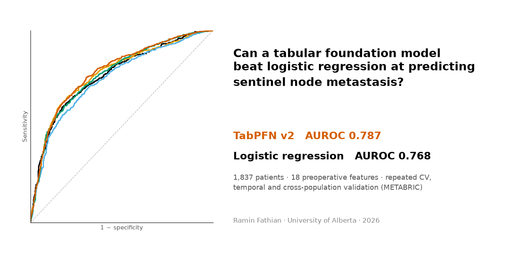
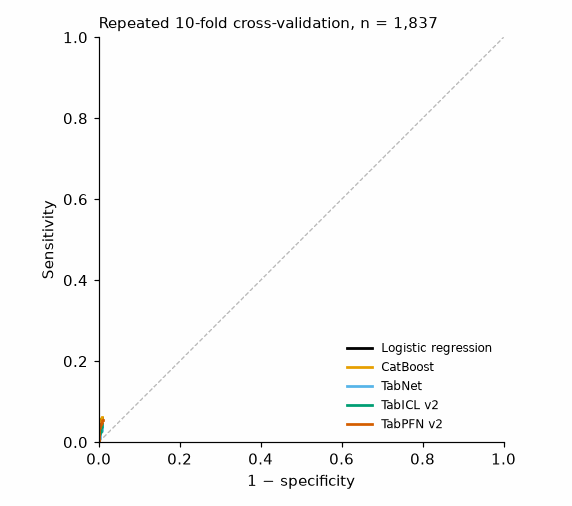
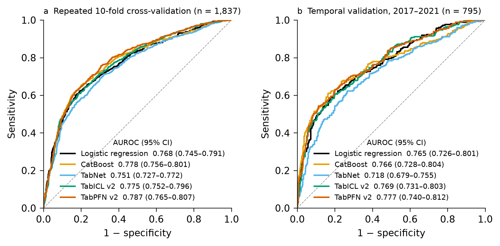
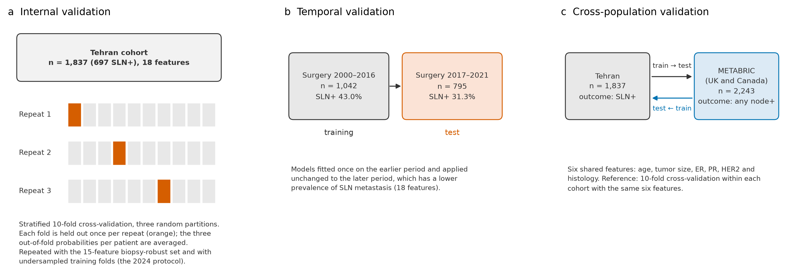
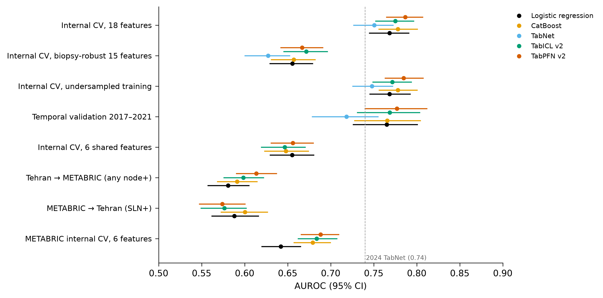
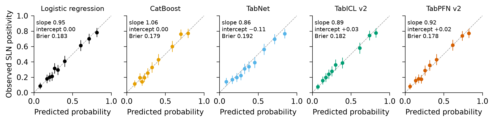
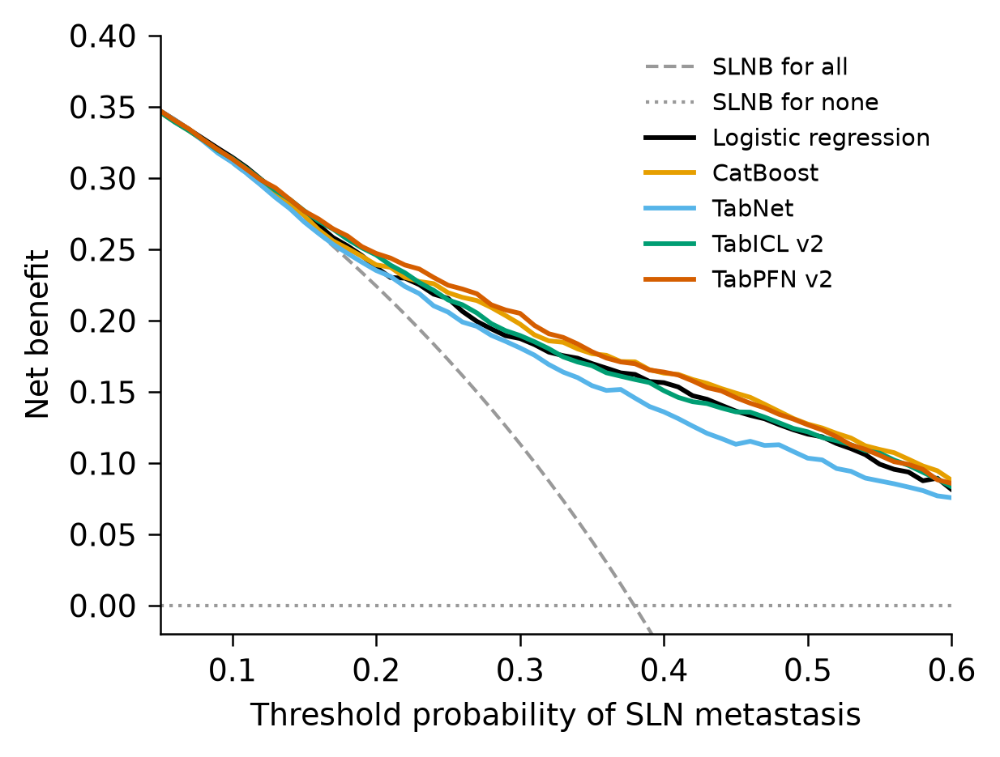
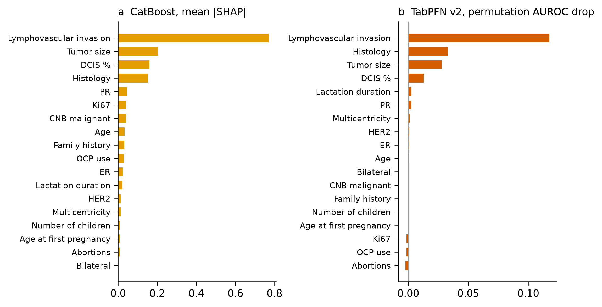
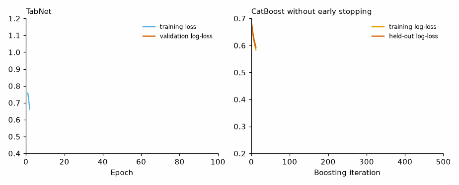
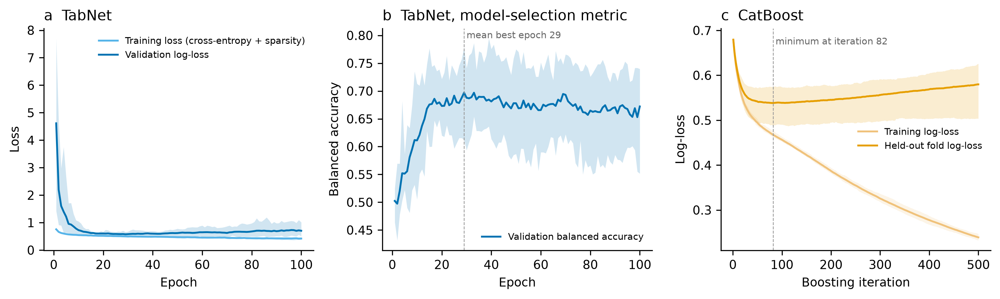

# Tabular foundation models for preoperative prediction of sentinel lymph node metastasis in breast cancer

<p align="center"></p>

[](https://doi.org/10.1038/s41598-024-51244-y)


**Ramin Fathian** · University of Alberta · 2026

Follow-up to [Shahriarirad et al., *Scientific Reports* 2024](https://doi.org/10.1038/s41598-024-51244-y), which trained TabNet on preoperative data from 1,837 breast cancer patients in Tehran to predict sentinel lymph node (SLN) metastasis. This project re-analyses the same cohort with the current generation of tabular foundation models (TabPFN v2, TabICL v2), a tuned gradient-boosting model (CatBoost), the original TabNet, and a plain logistic regression, under a validation protocol designed to be hard to fool: repeated cross-validation, temporal validation, and cross-population transfer to the public METABRIC cohort.

Manuscript in preparation. This repository is a results page: figures, animations and aggregate result tables. **No patient-level data, per-patient predictions, model weights or analysis code are included** (see [Data](#data-and-ethics)); the code will be released with the paper.

---

## Question

Sentinel lymph node biopsy is performed in almost every patient with early breast cancer, yet in about 60 % of them the node is negative and the operation brings only morbidity. Can a model trained on routine preoperative variables (age, reproductive history, receptor status, Ki67, core-biopsy histology, tumour size, lymphovascular invasion) identify patients at low enough risk to skip the biopsy? And do foundation models pretrained on synthetic tables add anything over a regression a surgeon could compute by hand?

## Headline results

Repeated stratified 10-fold cross-validation (3 repeats), 18 preoperative features, n = 1,837 (37.9 % SLN-positive):

| Model | AUROC (95 % CI) | Brier | Calibration slope | ΔAUROC vs logistic regression |
|---|---|---|---|---|
| **TabPFN v2** | **0.787** (0.765–0.807) | **0.178** | 0.92 | **+0.018** (0.009–0.028), p < 0.001 |
| CatBoost (early-stopped) | 0.778 (0.756–0.801) | 0.179 | 1.06 | +0.010 (−0.002–0.022), p = 0.14 |
| TabICL v2 | 0.775 (0.752–0.796) | 0.182 | 0.89 | +0.007 (−0.003–0.015), p = 0.16 |
| Logistic regression | 0.768 (0.745–0.791) | 0.183 | 0.95 | reference |
| TabNet (2024 hyperparameters) | 0.751 (0.727–0.772) | 0.192 | 0.86 | −0.018 (−0.032 to −0.004), p = 0.013 |

Three findings carry the paper:

1. **The foundation model wins, but narrowly.** TabPFN v2 is the only model significantly better than logistic regression, by 0.018 AUROC. The ranking holds in temporal validation (train ≤ 2016, test 2017–2021) and when the Tehran models are applied to METABRIC. The same +0.018 was obtained with TabPFN 2.5, 3 and 3.5 weights, so it is not a version artefact.
2. **The 2024 protocol flattered TabNet.** Every model, including logistic regression, exceeds the AUROC of 0.74 reported in 2024. Re-running with the original undersampling of the majority class leaves AUROC unchanged but produces a calibration intercept of −0.4 and doubles the calibration error: the models over-predict risk in a population that keeps its natural prevalence.
3. **The data, not the algorithm, set the ceiling.** Removing lymphovascular invasion, percentage of DCIS and multicentricity (features that depend on biopsy quality) drops every model to AUROC 0.63–0.67. Adding the registry variables the 2024 study left out (grade, perineural invasion, calcification, necrosis) adds at most 0.006.

<p align="center"></p>

<p align="center"></p>

*Figure 1. ROC curves of the five models in repeated 10-fold cross-validation (a) and in temporal validation on the 795 patients operated in 2017–2021 (b).*

## Validation designs

<p align="center"></p>

| Design | n (test) | Purpose |
|---|---|---|
| Internal CV, 18 features | 1,837 | Head-to-head comparison, paired bootstrap ΔAUROC |
| Internal CV, undersampled training folds | 1,837 | Reproduce the 2024 protocol and quantify its calibration cost |
| Internal CV, 15 biopsy-robust features | 1,837 | How much of the signal is lymphovascular invasion? |
| Temporal: train ≤ 2016 → test 2017–2021 | 795 | Drift in prevalence (43 % → 31 %) and practice |
| Tehran → METABRIC, 6 shared features | 2,232 | Cross-population transfer (outcome: any positive axillary node) |
| METABRIC → Tehran, 6 shared features | 1,837 | Reverse transfer |

<p align="center"></p>

*Figure 5. AUROC with 95 % bootstrap confidence intervals across all designs. The dashed line is the 0.74 reported for TabNet in 2024.*

## Calibration and clinical usefulness

<p align="center"></p>

*Figure 2. Calibration in cross-validation. Logistic regression, CatBoost, TabPFN and TabICL are well calibrated (expected calibration error 0.017–0.026); TabNet systematically over-predicts.*

<p align="center"></p>

*Figure 3. Decision curve analysis. All models beat "biopsy everyone" above a threshold probability of about 15 %. At a 20 % threshold TabPFN classifies 33 % of patients as low risk with an observed metastasis rate of 14 % among them, so no model yet reaches the safety margin needed to omit the biopsy on its own.*

## What drives the predictions

<p align="center"></p>

*Figure 4. CatBoost mean |SHAP| (a) and TabPFN permutation AUROC drop (b). Lymphovascular invasion dominates both; in the logistic regression it has an adjusted odds ratio of 6.8 (95 % CI 5.4–8.6). The full logistic regression equation is in [`results/lr_odds_ratios.csv`](results/lr_odds_ratios.csv).*

## Training behaviour

<p align="center"></p>

<p align="center"></p>

*Supplementary Figure 2. TabNet reaches its best validation loss after a mean of 29 epochs (range 17–93 across folds); CatBoost's validation log-loss is minimal at about 80 trees and rises afterwards, which is why 500 fixed trees (a common default) over-fit and early stopping was used.*

## Methods in brief

- **Cohort.** 1,837 patients with known SLN status from a single Tehran centre, 2000–2021; 18 preoperative features. External cohort: METABRIC (cBioPortal `brca_metabric`), 2,232 patients with recorded nodal status and at least one of the 6 shared features.
- **Models.** Logistic regression (KNN imputation, one-hot histology, C = 1); CatBoost (lr 0.05, depth 6, early stopping on a 10 % internal split); TabPFN v2 (`tabpfn` 2.0.9, GPU); TabICL v2 (`tabicl` 2.2.0); TabNet with the 2024 hyperparameters (`pytorch-tabnet` 4.1.0). All preprocessing fitted inside the training folds.
- **Metrics.** AUROC, AUPRC, Brier score, log-loss, calibration slope and intercept, expected calibration error, sensitivity/specificity at 0.5 and at the Youden threshold, rule-out tables at 10–30 % thresholds, decision curves. 2,000 bootstrap resamples for confidence intervals; paired bootstrap for ΔAUROC against logistic regression.
- **Reporting.** TRIPOD+AI.

## Repository layout

```
figures/   Figures 1–5 and S1–S2 as PNG and PDF, the banner and the two animations
results/   aggregate metrics with confidence intervals, calibration, decision-curve and rule-out
           tables, feature importance, logistic regression odds ratios, training curves
```

Every file in `results/` is a summary over the cohort (one row per model, threshold or decile). Nothing is at patient level. Cells describing fewer than five patients are suppressed.

## Data and ethics

The Tehran cohort contains patient-level clinical data collected under the ethics approval of the original study and is available from the corresponding author of the 2024 paper on reasonable request. It is not part of this repository, and neither are per-patient predictions or fitted model weights; only the logistic regression equation is released. METABRIC is public through cBioPortal. The analysis code will be published with the paper.

## Two notes for anyone repeating this

- `tabpfn` 2.0.9 enters an infinite loop in its fingerprint-feature step when a row has every feature missing (the hash never changes). Eleven METABRIC rows with none of the six shared features triggered a 14-hour hang and were excluded from the cross-population design.
- CatBoost with a fixed 500 trees over-fits this cohort (validation log-loss minimal near 80 trees). Early stopping was used throughout.

## Citation

Project page: Fathian R. *Tabular foundation models for preoperative prediction of sentinel lymph node metastasis in breast cancer.* GitHub, 2026 (see `CITATION.cff`).

Original study: Shahriarirad R, Meshkati Yazd SM, Fathian R, Fallahi M, Ghadiani Z, Nafissi N. Prediction of sentinel lymph node metastasis in breast cancer patients based on preoperative features: a deep learning approach. *Sci Rep.* 2024;14:1351. https://doi.org/10.1038/s41598-024-51244-y

## License

Figures, animations, result tables and text on this page are released under [CC BY 4.0](https://creativecommons.org/licenses/by/4.0/): reuse with attribution to Ramin Fathian and a link to this page.
